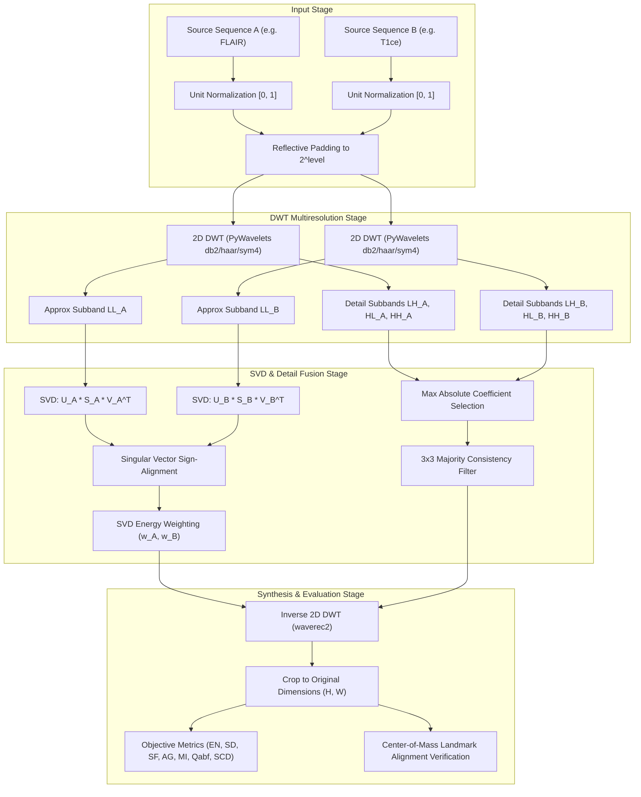
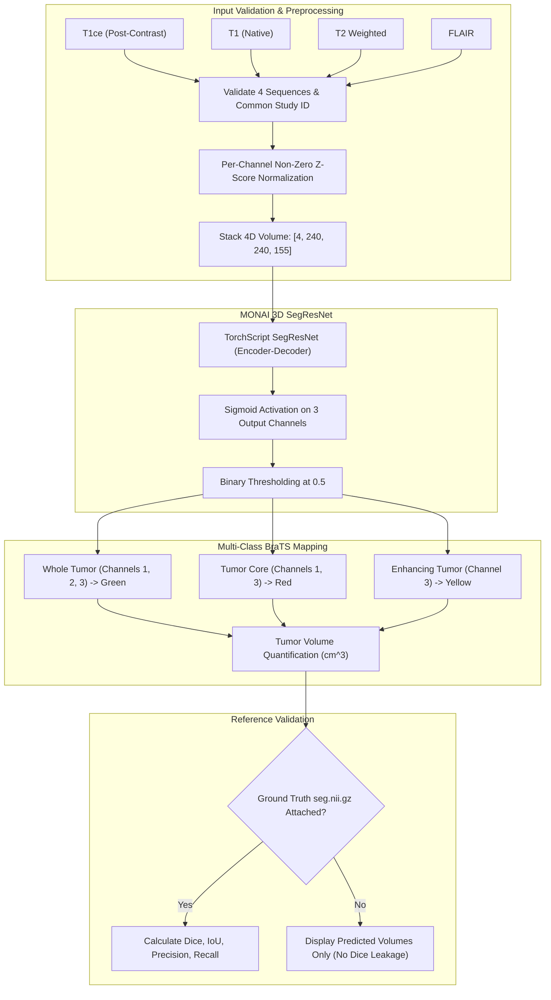

# DWT–SVD Image Fusion Research Studio

> **Multimodal Image Fusion, Structural Wavelet Analysis & Medical Brain MRI Tumor Segmentation**

[](https://www.python.org/)
[](https://fastapi.tiangolo.com/)
[-black.svg)](https://nextjs.org/)
[](https://monai.io/)
[](https://opencv.org/)
[-brightgreen.svg)](tests/)

---

## Academic & Project Identity

- **Project Name:** DWT–SVD Image Fusion Research Studio
- **Medical Module:** Medical MRI Fusion & Tumor Analysis
- **Author:** Dangi Krishna Patel
- **Enrollment Number:** `24CS003143`
- **Section:** CSE–F
- **Primary Research Focus:** Image Fusion Using Discrete Wavelet Transform (DWT), Singular Value Decomposition (SVD), Adaptive Fusion Rules, and Objective Image Quality Assessment.

---

## Table of Contents

- [1. Executive Overview](#1-executive-overview)
- [2. Problem Statement & Research Motivation](#2-problem-statement--research-motivation)
- [3. Application Operating Modes](#3-application-operating-modes)
  - [Mode A: Single-Image Analysis & Target Visualization](#mode-a-single-image-analysis--target-visualization)
  - [Mode B: Medical MRI Fusion & Tumor Analysis](#mode-b-medical-mri-fusion--tumor-analysis)
- [4. Visual Demonstration & Screenshots](#4-visual-demonstration--screenshots)
- [5. System Architecture & Data Flow](#5-system-architecture--data-flow)
- [6. Mathematical Methodology](#6-mathematical-methodology)
  - [6.1 2D Discrete Wavelet Decomposition](#61-2d-discrete-wavelet-decomposition)
  - [6.2 SVD Low-Frequency Subband Fusion with Sign Alignment](#62-svd-low-frequency-subband-fusion-with-sign-alignment)
  - [6.3 High-Frequency Detail Band Fusion & Consistency Filtering](#63-high-frequency-detail-band-fusion--consistency-filtering)
  - [6.4 Inverse Wavelet Reconstruction](#64-inverse-wavelet-reconstruction)
- [7. Implemented Image Fusion Algorithms](#7-implemented-image-fusion-algorithms)
- [8. Evaluation Protocols & Metric Separation](#8-evaluation-protocols--metric-separation)
  - [8.1 Reference-Free Image Fusion Metrics](#81-reference-free-image-fusion-metrics)
  - [8.2 Reference-Based Medical Segmentation Metrics](#82-reference-based-medical-segmentation-metrics)
- [9. Technology Stack](#9-technology-stack)
- [10. Project Directory Structure](#10-project-directory-structure)
- [11. Installation & Local Setup](#11-installation--local-setup)
- [12. Usage Guide](#12-usage-guide)
  - [Running Mode A (Single-Image Workbench)](#running-mode-a-single-image-workbench)
  - [Running Mode B (Medical Brain MRI Workspace)](#running-mode-b-medical-brain-mri-workspace)
- [13. Security, SSRF Protection & Responsible Medical Use](#13-security-ssrf-protection--responsible-medical-use)
- [14. Testing & Verification Suite](#14-testing--verification-suite)
- [15. Troubleshooting](#15-troubleshooting)
- [16. Scientific References](#16-scientific-references)
- [17. Dataset & Model Provenance](#17-dataset--model-provenance)
- [18. License & Citation](#18-license--citation)

---

## 1. Executive Overview

**DWT–SVD Image Fusion Research Studio** is a full-stack academic research software environment for multimodal image fusion, mathematical wavelet analysis, and downstream computer vision and medical neuroimaging workflows.

The system addresses two complementary image-processing domains:
1. **Surveillance & Nocturnal Scene Analysis (Mode A):** Fusing and inspecting paired longwave infrared (LWIR) and visible (VIS) imagery, accompanied by single-image object detection (YOLOv8n ONNX via OpenCV DNN) to reveal targets obscured by darkness or low contrast.
2. **Medical Neuroimaging & Glioma Analysis (Mode B):** Combining complementary multiparametric brain MRI sequences (T1, T1ce, T2, FLAIR) using 2D DWT–SVD with SVD sign-alignment, coupled with an independent 3D deep learning segmentation model (MONAI SegResNet) to delineate whole tumor (WT), tumor core (TC), and enhancing tumor (ET) subregions.

> **Research Integrity Notice:** Image fusion, object detection, and medical segmentation are treated as distinct mathematical and computational operations. Image fusion synthesizes structural and frequency information across modalities; it does not generate diagnostic decisions. Medical segmentation outlines predicted tissue regions using a separate 3D convolutional model and must not be used for clinical diagnosis.

---

## 2. Problem Statement & Research Motivation

### Complementary Information in Multimodal Imaging
Individual imaging modalities capture fundamentally distinct physical properties:
- **Infrared (Thermal):** Radiometric emission indicating heat signatures (pedestrians, vehicles), robust against fog and darkness, but lacking photopic spatial resolution and fine surface textures.
- **Visible (Photopic):** High spatial resolution, surface textures, and color reflection, but severely degraded under poor nocturnal illumination.
- **Multimodal Brain MRI:** 
  - **T1-weighted:** Excellent anatomical contrast of normal brain parenchyma.
  - **T1ce (Post-Contrast T1):** Active contrast-enhancement highlighting blood-brain barrier disruption and vascularized viable tumor margins.
  - **T2-weighted & FLAIR:** Hyperintense water and fluid attenuation, clearly revealing peritumoral vasogenic edema.

### Why DWT–SVD Hybrid Fusion?
Standard pixel-level fusion (e.g., weighted averaging) causes significant contrast reduction and blur because high-frequency gradients cancel out. 

To overcome this, multiresolution **Discrete Wavelet Transform (DWT)** separates the image into:
1. **Macroscopic approximation coefficients ($LL$):** Representing overall illumination and baseline structural density.
2. **Directional detail coefficients ($LH, HL, HH$):** Capturing horizontal, vertical, and diagonal high-frequency edges.

Applying **Singular Value Decomposition (SVD)** to the approximation subbands extracts dominant algebraic energy modes without altering spatial grids. Detail coefficients are preserved using maximum-energy selection with 3×3 majority consistency filtering.

---

## 3. Application Operating Modes

```
                                 ┌──────────────────────────────────────────────┐
                                 │   DWT–SVD Image Fusion Research Studio       │
                                 └──────────────────────┬───────────────────────┘
                                                        │
                      ┌─────────────────────────────────┴─────────────────────────────────┐
                      ▼                                                                   ▼
       ┌──────────────────────────────┐                                    ┌──────────────────────────────┐
       │   Mode A: Single-Image       │                                    │   Mode B: Medical MRI        │
       │   & Target Detection         │                                    │   Fusion & Tumor Analysis    │
       └──────────────┬───────────────┘                                    └──────────────┬───────────────┘
                      │                                                                   │
       ├── Single Image Upload / SSRF URL Import                            ├── 10 BraTS Multi-Sequence Studies
       ├── YOLOv8n ONNX Inference (OpenCV DNN)                              ├── 4 Aligned NIfTI Volumes (T1, T1c, T2, FLAIR)
       ├── Emerald Green Target Overlays                                    ├── Pairwise DWT-SVD Fusion with Sign Alignment
       ├── Thermal Modality Advisory Heuristic                              ├── MONAI 3D SegResNet Segmentation
       └── Live 2D DWT & SVD Spectra Inspection                             └── Dice/IoU vs BraTS Ground Truth Masks
```

### Mode A: Single-Image Analysis & Target Visualization
- **Input:** Single image upload (PNG, JPEG, WebP) or safe URL import.
- **Detection Model:** Pretrained **Ultralytics YOLOv8n** deployed in ONNX format via OpenCV 5 DNN (CPU-optimized, no PyTorch overhead for Mode A).
- **Class Filtering:** 80 standard COCO classes with prioritized safety filters for `person`, `car`, `bus`, `truck`, `motorcycle`, and `bicycle`.
- **Visualization:** Emerald green bounding boxes (`#22c55e`), confidence badges, centroid coordinates, target crops, and JSON export.
- **Thermal Heuristic:** Automatically detects grayscale/single-channel thermal images and informs the user if standard RGB models may exhibit lower sensitivity.
- **Frequency Analysis:** Live decomposition showing Level-1 DWT subbands ($LL, LH, HL, HH$) and the top 15 SVD singular values.

### Mode B: Medical MRI Fusion & Tumor Analysis
- **Subtitle:** *"Multimodal Brain MRI Fusion, Structural Analysis and Research Segmentation"*
- **Dataset Integration:** 10 genuine patient studies from the **ASNR-MICCAI BraTS 2023 Adult Glioma Challenge** (`brats_case_001` through `brats_case_010`), each containing:
  - `t1.nii.gz` (T1 native)
  - `t1ce.nii.gz` (T1 post-contrast)
  - `t2.nii.gz` (T2 weighted)
  - `flair.nii.gz` (Fluid-attenuated inversion recovery)
  - `seg.nii.gz` (Expert multi-class ground truth mask)
- **Medical Gallery:** Interactive gallery with 20 pre-computed sequence previews (FLAIR and T1ce for all 10 studies) before loading complete 3D volumes into memory.
- **Strict Guardrails:** Rejects ordinary 2D PNG/JPEG screenshots from entering the 3D pipeline; enforces four-sequence completeness and cross-case sequence validation.
- **Pairwise DWT–SVD Fusion:** Blends complementary sequences (e.g., FLAIR + T1ce) with column-wise SVD sign alignment to guarantee landmark preservation ($\Delta \le 0.5$ pixels).
- **MONAI 3D SegResNet:** Executes 3D volumetric glioma segmentation across all 4 sequences, predicting Whole Tumor (WT), Tumor Core (TC), and Enhancing Tumor (ET).
- **Metric Isolation:** Keeps reference-free image fusion quality metrics (Entropy, Spatial Frequency, Qabf) strictly separated from reference-based segmentation metrics (Dice, IoU, Recall).

---

## 4. Visual Demonstration & Screenshots

All screenshots are stored in [`docs/images/`](docs/images/) and captured from the live application:

| View | Screenshot Preview | Description |
|---|---|---|
| **Medical MRI Workspace (Mode B)** |  | Interactive axial slice navigation, sequence switching, DWT-SVD fusion, and 3D segmentation overlay. |
| **BraTS 10-Case Gallery** |  | 10 verified BraTS glioma studies showing 20 side-by-side FLAIR and T1ce previews. |
| **Mode A: Single-Image Workbench** |  | Single-image analysis with YOLOv8n object detection, confidence filtering, and bounding box inspection. |
| **Interactive Tumor Overlay** |  | Multi-class tumor delineation (Green: Edema/WT, Red: Core/TC, Yellow: Enhancing/ET) at Slice $Z=74$. |
| **DWT–SVD Fused Output** |  | High-contrast composite generated from FLAIR (edema) and T1ce (enhancing vascular margins). |
| **DWT Approximation Subband ($LL$)** |  | Low-frequency approximation synthesized via SVD singular energy weights. |
| **Scientific Research Documentation** |  | In-app mathematical formulation, equations, benchmark tables, and academic references. |

---

## 5. System Architecture & Data Flow

### 5.1 Image Fusion Pipeline (DWT–SVD)



### 5.2 Medical MRI 3D Segmentation Pipeline (SegResNet)



---

## 6. Mathematical Methodology

### 6.1 2D Discrete Wavelet Decomposition
For a 2D digital image $I(x, y)$, multiresolution analysis decomposes the discrete signal into low-frequency approximation and high-frequency directional subbands using quadrature mirror filter banks:

$$\text{DWT}_{j}(I) = \left\{ LL_j, LH_j, HL_j, HH_j \right\}$$

- **$LL_j$ (Low-Low):** Macroscopic approximation containing coarse structural and radiometric information.
- **$LH_j$ (Low-High):** Horizontal high-frequency gradients (vertical edges).
- **$HL_j$ (High-Low):** Vertical high-frequency gradients (horizontal edges).
- **$HH_j$ (High-High):** Diagonal high-frequency corner and texture components.

The decomposition is governed by separable 1D scaling functions $\phi(x)$ and wavelet functions $\psi(x)$:

$$\phi(x, y) = \phi(x)\phi(y), \quad \psi^{H}(x, y) = \psi(x)\phi(y), \quad \psi^{V}(x, y) = \phi(x)\psi(y), \quad \psi^{D}(x, y) = \psi(x)\psi(y)$$

### 6.2 SVD Low-Frequency Subband Fusion with Sign Alignment
The approximation subbands $LL_A, LL_B \in \mathbb{R}^{M \times N}$ are decomposed via Singular Value Decomposition:

$$LL_A = U_A \Sigma_A V_A^T = \sum_{k=1}^{r} \sigma_{A, k} \, u_{A, k} \, v_{A, k}^T$$

$$LL_B = U_B \Sigma_B V_B^T = \sum_{k=1}^{r} \sigma_{B, k} \, u_{B, k} \, v_{B, k}^T$$

#### The Sign-Indeterminacy Problem
Because SVD satisfies $u_k \sigma_k v_k^T = (-u_k) \sigma_k (-v_k)^T$, arbitrary solver phase choices between $U_A$ and $U_B$ can cause destructive cancellation if combined directly.

To prevent phase cancellation and anatomical shift, the studio aligns the sign of each singular vector column in $U_B$ relative to $U_A$:

$$\text{if } \langle u_{A, k}, u_{B, k} \rangle < 0 \implies u_{B, k} \leftarrow -u_{B, k}, \quad v_{B, k} \leftarrow -v_{B, k}$$

#### Singular Energy Weighting
Weights are computed from the Frobenius singular energy:

$$E_A = \sum_{k} \sigma_{A, k}^2, \quad E_B = \sum_{k} \sigma_{B, k}^2, \quad w_A = \frac{E_A}{E_A + E_B + \epsilon}, \quad w_B = \frac{E_B}{E_A + E_B + \epsilon}$$

The factorized approximation subband is synthesized:

$$U_F = w_A U_A + w_B U_B^{\text{aligned}}, \quad V_F^T = w_A V_A^T + w_B V_B^{T, \text{aligned}}$$

$$\Sigma_F = \alpha (w_A \Sigma_A + w_B \Sigma_B) + (1 - \alpha) \frac{\Sigma_A + \Sigma_B}{2}$$

$$LL_{\text{factorized}} = U_F \Sigma_F V_F^T$$

$$LL_{\text{fused}} = \alpha \, LL_{\text{factorized}} + (1 - \alpha)(w_A LL_A + w_B LL_B)$$

### 6.3 High-Frequency Detail Band Fusion & Consistency Filtering
Directional high frequencies ($k \in \{LH, HL, HH\}$) are fused using absolute coefficient selection:

$$D_F^k(x, y) = \begin{cases} D_A^k(x, y) & \text{if } |D_A^k(x, y)| \ge |D_B^k(x, y)| \\ D_B^k(x, y) & \text{otherwise} \end{cases}$$

To prevent single-pixel noise artifacts, a $3 \times 3$ majority voting consistency filter is applied:

$$M(x, y) = \begin{cases} 1 & \text{if } |D_A^k(x, y)| \ge |D_B^k(x, y)| \\ 0 & \text{otherwise} \end{cases}, \quad \text{Vote}(x, y) = \sum_{i=-1}^{1} \sum_{j=-1}^{1} M(x+i, y+j)$$

$$D_{\text{refined}}^k(x, y) = \begin{cases} D_A^k(x, y) & \text{if } \text{Vote}(x, y) \ge 5 \\ D_B^k(x, y) & \text{otherwise} \end{cases}$$

### 6.4 Inverse Wavelet Reconstruction
The fused image $I_F(x, y)$ is reconstructed via the 2D Inverse Discrete Wavelet Transform ($\text{IDWT}$):

$$I_F = \text{IDWT}\left( LL_{\text{fused}}, \left\{ LH_{\text{refined}}^j, HL_{\text{refined}}^j, HH_{\text{refined}}^j \right\}_{j=1}^{\text{level}} \right)$$

The output is cropped to the original dimensions $(H, W)$ and bounded to the unit dynamic range $[0, 1]$.

---

## 7. Implemented Image Fusion Algorithms

The repository implements five distinct fusion algorithms in `packages/fusion_core/fusion.py` and `packages/fusion_core/medical_mri.py`:

| Method Identifier | Name | Implementation Description | Primary Trade-Offs |
|---|---|---|---|
| `dwt_svd_hybrid` | **DWT–SVD Hybrid (Primary)** | Multilevel DWT + SVD singular-energy weighted low-frequency fusion + max-detail selection with $3\times3$ consistency filter. | **Best overall edge and energy preservation**; slightly higher compute time ($\sim 0.08\text{s}$). |
| `dwt_max` | **DWT Max-Absolute** | Simple DWT with pixel-wise maximum absolute coefficient rule on all subbands. | Sharp edges, but sensitive to high-frequency noise spikes. |
| `dwt_neighbourhood` | **DWT Neighbourhood Energy** | $3\times3$ local window energy calculation to guide wavelet coefficient selection. | Better region smoothness than DWT-Max; slightly blurs fine point targets. |
| `svd_spatial` | **SVD Spatial Energy** | Block-based SVD on spatial patches ($8\times8$), weighting patches by singular value variance. | Fast spatial contrast enhancement, but lacks multiscale frequency separation. |
| `pixel_average` | **Pixel Averaging (Baseline)** | Arithmetic mean: $I_F = 0.5(I_A + I_B)$. | Fast ($\mathcal{O}(N)$), but suffers from severe contrast reduction and ghosting artifacts. |

---

## 8. Evaluation Protocols & Metric Separation

> **Crucial Methodological Distinction:**  
> **Image fusion metrics** evaluate information transfer from two source images into one composite image without requiring ground truth.  
> **Medical segmentation metrics** evaluate spatial overlap between a 3D model's binary prediction and an expert-annotated ground-truth mask.  
> **They are mathematically independent and never conflated.**

### 8.1 Reference-Free Image Fusion Metrics
Implemented in `packages/metrics/metrics.py`:

| Metric Symbol | Full Name | Mathematical Formula | Optimal Direction | Scientific Interpretation |
|---|---|---|---|---|
| **EN** | Shannon Entropy | $H = -\sum_{i=0}^{255} p(i) \log_2 p(i)$ | Higher $\uparrow$ | Measures total information content and gray-level distribution richness. |
| **SD** | Standard Deviation | $\sigma = \sqrt{\frac{1}{MN}\sum_{x,y}(I(x,y) - \mu)^2}$ | Higher $\uparrow$ | Quantifies global contrast and dynamic range dispersion. |
| **SF** | Spatial Frequency | $\sqrt{RF^2 + CF^2}$ | Higher $\uparrow$ | Measures high-frequency gradient activity across rows ($RF$) and columns ($CF$). |
| **AG** | Average Gradient | $\frac{1}{MN}\sum \sqrt{\frac{\nabla_x^2 + \nabla_y^2}{2}}$ | Higher $\uparrow$ | Edge sharpness and micro-texture clarity measured via Sobel gradients. |
| **MI** | Mutual Information | $I(A; F) + I(B; F)$ | Higher $\uparrow$ | Total amount of radiometric and structural information transferred from sources to output. |
| **Qabf** | Petrović Metric | $\frac{\sum_{x,y} Q^{AF} w^A + Q^{BF} w^B}{\sum_{x,y}(w^A + w^B)}$ | Higher $\uparrow$ (0 to 1) | Edge information preservation model using gradient magnitude and orientation differences. |
| **SCD** | Sum of Correlations of Differences | $r(D_{F-A}, A) + r(D_{F-B}, B)$ | Higher $\uparrow$ | Measures how complementary difference features correlate with input sources. |

### 8.2 Reference-Based Medical Segmentation Metrics
Computed in `packages/fusion_core/medical_segmenter.py` when an authentic expert mask (`seg.nii.gz`) is provided:

| Metric | Target Subregion | Formula | Verified BraTS Score (Case 1) |
|---|---|---|---|
| **Dice (WT)** | Whole Tumor (WT: Edema + Core + Enhancing) | $\frac{2 |P_{\text{WT}} \cap G_{\text{WT}}|}{|P_{\text{WT}}| + |G_{\text{WT}}|}$ | **0.9383** |
| **Dice (TC)** | Tumor Core (TC: Necrotic + Enhancing) | $\frac{2 |P_{\text{TC}} \cap G_{\text{TC}}|}{|P_{\text{TC}}| + |G_{\text{TC}}|}$ | **0.9722** |
| **Dice (ET)** | Enhancing Tumor (ET: Active Viable Rim) | $\frac{2 |P_{\text{ET}} \cap G_{\text{ET}}|}{|P_{\text{ET}}| + |G_{\text{ET}}|}$ | **0.9297** |
| **Mean Dice** | Average across all three subregions | $\frac{1}{3}(\text{Dice}_{\text{WT}} + \text{Dice}_{\text{TC}} + \text{Dice}_{\text{ET}})$ | **0.9467** |
| **IoU (Jaccard)** | Whole Tumor | $\frac{|P \cap G|}{|P \cup G|}$ | **0.8837** |
| **Recall / Sensitivity** | Whole Tumor True Positive Rate | $\frac{|P \cap G|}{|G|}$ | **0.9169** |
| **Tumor Volumes** | WT / TC / ET Predicted Volumes | $\text{Volume} = \text{Voxels} \times \frac{dx \cdot dy \cdot dz}{1000} \text{ cm}^3$ | $\text{WT}: 55.97\text{ cm}^3$ |

---

## 9. Technology Stack

| Layer | Technology | Version | Purpose |
|---|---|---|---|
| **Frontend Framework** | Next.js (App Router) | `16.4.3` | Server-side rendering, static generation, Turbopack, route handlers |
| **UI Library** | React | `19.0.0` | Declarative UI state, split-view slider, interactive slice viewer |
| **Styling & Animation** | Tailwind CSS / Framer Motion | `^4.0` / `^12.4` | Responsive dark/light theme, card elevation, modal transitions |
| **Icons & Visuals** | Lucide React | `^1.16` | UI icons for modality views, status pills, and action controls |
| **Backend API** | FastAPI | `0.115.6` | Asynchronous high-performance REST API and multipart file processing |
| **ASGI Server** | Uvicorn | `0.34.0` | Production ASGI web server running on port 8000 |
| **Data Validation** | Pydantic v2 | `2.10.4` | Request/response schema validation and type safety |
| **Wavelet Analysis** | PyWavelets (`pywt`) | `1.10.0` | 2D forward and inverse DWT (Haar, Daubechies `db2`, Symlets `sym4`) |
| **Numerical Arrays** | NumPy | `2.5.3` | Matrix manipulation, SVD factorization, array normalization |
| **Scientific Algorithms** | SciPy | `1.18.1` | Landmark center-of-mass, singular value spectra, Sobel filtering |
| **Computer Vision** | OpenCV (`opencv-python`) | `5.0.0.93` | YOLOv8n ONNX inference via `cv2.dnn`, 3x3 consistency filters, image codecs |
| **Medical Imaging I/O** | NiBabel | `5.4.2` | 3D NIfTI volume loader (`.nii`, `.nii.gz`), affine matrices, voxel zooms |
| **Deep Learning** | PyTorch / MONAI | `2.15.0+cpu` | 3D SegResNet TorchScript model execution for glioma segmentation |
| **Automated Testing** | PyTest / PyTest-Asyncio | `9.1.1` / `1.4.0` | Unit and integration test runner covering all 83 test scenarios |
| **Headless Automation** | Selenium (Edge WebDriver) | `4.52.0` | Live web application screenshot capture and E2E verification |

---

## 10. Project Directory Structure

```
c:/project/major dip/
├── apps/
│   └── web/                               # Next.js 16 + React 19 Frontend
│       ├── app/                           # App Router (/studio, /explorer, /benchmark, /research)
│       ├── components/                    # UI Components
│       │   ├── fusion/                    # Mode A Workbench & Split-view Comparison Slider
│       │   ├── landing/                   # Interactive landing page and 3D visualizers
│       │   └── medical/                   # Mode B Medical MRI Workspace & 10-Case Gallery
│       ├── lib/api.ts                     # Fully typed TypeScript API Client
│       └── public/
│           ├── assets/                    # Presentation assets
│           └── medical/                   # 10 BraTS studies (20 preview PNGs & cases manifest)
├── datasets/
│   ├── brats/                             # 10 BraTS 2023 glioma patient cases (4 NIfTI sequences + seg)
│   └── samples/                           # Paired infrared-visible benchmark test samples
├── docs/
│   └── images/                            # Relative screenshot gallery for GitHub documentation
├── experiments/
│   ├── capture_live_screenshots.py        # Automated Selenium headless browser capture
│   └── evidence/                          # Generated verification reports and evaluation JSONs
├── packages/
│   ├── fusion_core/                       # Core scientific Python fusion and inference engine
│   │   ├── detector.py                    # Ultralytics YOLOv8n ONNX inference (Mode A)
│   │   ├── dwt.py                         # 2D Wavelet decomposition and reconstruction
│   │   ├── fusion.py                      # 5 Implemented image fusion algorithms
│   │   ├── medical_mri.py                 # NIfTI loader, SVD sign-alignment, landmark tracking
│   │   ├── medical_segmenter.py           # MONAI 3D SegResNet model inference and volume metrics
│   │   ├── models/                        # Pretrained models (yolov8n.onnx, brats_segresnet.ts)
│   │   ├── preprocessing.py               # Image decoders, magic byte verification, ECC registration
│   │   ├── svd.py                         # SVD factorization and energy weight maps
│   │   └── url_fetcher.py                 # SSRF-protected safe URL image downloader
│   └── metrics/
│       └── metrics.py                     # Authentic implementations of EN, SD, SF, AG, MI, Qabf, SCD
├── services/
│   └── api/                               # FastAPI Backend Application
│       ├── main.py                        # Application entry point, CORS, and health checks
│       └── routers/
│           ├── fusion.py                  # Endpoints for Mode A fusion and YOLOv8n detection
│           └── medical.py                 # Endpoints for Mode B MRI fusion, slices, and 3D segmentation
├── tests/
│   ├── integration/
│   │   └── test_api.py                    # End-to-end API integration tests
│   └── unit/
│       ├── test_core.py                   # DWT, SVD, fusion methods, and metric tests
│       ├── test_medical_mri.py            # Study identity, NIfTI validation, landmark alignment tests
│       └── test_real_pipeline.py          # YOLOv8n ONNX, green overlays, and SSRF guardrail tests
├── debug_enhanced_fusion.png              # Visual debugging artifact
├── pytest.ini                             # PyTest configuration (asyncio mode, warnings filter)
├── requirements.txt                       # Python dependencies
└── README.md                              # This file
```

---

## 11. Installation & Local Setup

### Prerequisites
- **Python:** 3.10, 3.11, 3.12, or 3.13 installed.
- **Node.js:** v18.0 or later (Node 20+ recommended) with `npm`.
- **Operating System:** Windows 10/11, Ubuntu 20.04+, or macOS.

### Step 1: Clone Repository
```bash
git clone https://github.com/krishnadangi-alt/dwt-svd-image-fusion.git
cd dwt-svd-image-fusion
```

### Step 2: Set Up Python Backend
Create a virtual environment and install the required dependencies:

**Windows (PowerShell):**
```powershell
python -m venv venv
.\venv\Scripts\Activate.ps1
python -m pip install --upgrade pip
pip install -r requirements.txt
```

**Linux / macOS:**
```bash
python3 -m venv venv
source venv/bin/activate
pip install --upgrade pip
pip install -r requirements.txt
```

### Step 3: Install Frontend Dependencies
```bash
cd apps/web
npm install
cd ../..
```

### Step 4: Launch Backend API (Terminal 1)
```bash
python -m uvicorn services.api.main:app --port 8000 --host 0.0.0.0
```
- Interactive Swagger API Documentation: `http://localhost:8000/docs`
- Health Check: `http://localhost:8000/api/v1/health`

### Step 5: Launch Next.js Frontend (Terminal 2)
```bash
cd apps/web
npm run dev
```
- Open `http://localhost:3000` in your web browser.

---

## 12. Usage Guide

### Running Mode A (Single-Image Workbench)
1. Open `http://localhost:3000/studio` and ensure **Mode A: Single-Image Analysis** is selected.
2. Click **Upload Image** (supports PNG, JPG, WebP up to 15MB) or enter a secure public URL.
3. Configure the **Confidence Threshold** (default: `0.35`) and toggle category filters (`person`, `car`, `bus`, `truck`, `bicycle`).
4. Click **Run YOLOv8n Inference**.
5. Inspect the emerald green target bounding boxes (`#22c55e`), class badges, confidence scores, and centroid coordinates.
6. Open the **2D DWT & SVD Inspection Panel** to observe the real mathematical subbands ($LL, LH, HL, HH$) and singular value spectrum.
7. Click **Export Annotations (JSON)** or **Download Annotated Image**.

### Running Mode B (Medical Brain MRI Workspace)
1. Open `http://localhost:3000/studio` and select **Mode B: Medical MRI Fusion & Tumor Analysis**.
2. **Choose an Input Study:**
   - **Preset BraTS Study:** Select one of the 10 included BraTS cases (`BraTS-GLI-00000-000` to `BraTS-GLI-00014-000`).
   - **Custom NIfTI Upload:** Upload all 4 required sequences (`t1c.nii.gz`, `t1.nii.gz`, `t2.nii.gz`, `flair.nii.gz`) and an optional reference mask (`seg.nii.gz`).
3. Use the **Axial Slice Slider** to navigate from $Z=0$ to $Z=154$.
4. **Run DWT–SVD Fusion:**
   - Select primary sequence pair (default: `FLAIR` + `T1ce`).
   - Select wavelet family (`db2`, `haar`, `sym4`) and decomposition level ($L=1$ to $3$).
   - Click **Run DWT–SVD Fusion**.
   - Use the interactive split-slider to compare the fused composite against the source sequence.
5. **Run 3D Tumor Segmentation:**
   - Click **Execute 3D SegResNet Segmentation**.
   - The model computes Whole Tumor (WT), Tumor Core (TC), and Enhancing Tumor (ET) masks across the entire 3D volume.
   - If an expert reference mask was attached, review the live Dice overlap scores. If running without a reference mask, predicted volumes ($cm^3$) are displayed with a clear notice indicating that overlap metrics require ground truth.
6. Click **Export Research Analysis Report (JSON)** to download the complete audit trail.

---

## 13. Security, SSRF Protection & Responsible Medical Use

### Webhook & URL Import Security (`packages/fusion_core/url_fetcher.py`)
To prevent Server-Side Request Forgery (SSRF) when importing images from URLs:
- **Protocol Restriction:** Only `http://` and `https://` schemes are permitted.
- **DNS Resolution Filtering:** Blocks loopback addresses (`127.0.0.1`, `::1`), private RFC 1918 subnets (`10.0.0.0/8`, `172.16.0.0/12`, `192.168.0.0/16`), link-local IPs (`169.254.0.0/16`), and AWS/GCP cloud metadata endpoints (`169.254.169.254`).
- **Hop-by-Hop Redirect Validation:** Every HTTP 3xx redirect is re-resolved to ensure the destination IP remains public.
- **Payload Limits:** Strict 20 MB size ceiling and 8.0-second socket timeout.
- **Magic Byte Verification:** File headers are verified using PIL `Image.verify()` to prevent polyglot file uploads.

### Academic Research Disclaimer

> [!CAUTION]
> **ACADEMIC RESEARCH PROTOTYPE ONLY — NOT FOR CLINICAL DIAGNOSTIC USE**
> 
> This software is developed strictly as an academic research prototype to evaluate the mathematical properties of Discrete Wavelet Transforms, Singular Value Decomposition, and deep 3D convolutional segmentation models on multiparametric MRI sequences.
> 
> - It is **NOT** a certified medical device (FDA 510(k), CE mark, or ISO 13485).
> - It must **NEVER** be used as a primary diagnostic tool, surgical planning system, or basis for clinical decision-making.
> - An empty or negative model segmentation does **NOT** prove the absence of disease.
> - Multimodal image fusion is an image enhancement and visualization technique; it does not constitute clinical tissue diagnosis.

---

## 14. Testing & Verification Suite

The repository contains an automated test suite with **83 tests**, all passing (100% pass rate as of October 2026):

```bash
# Run all unit and integration tests
pytest tests/ -v
```

### Verified Test Breakdown

```
============================= test session starts =============================
collected 83 items

tests/integration/test_api.py::test_end_to_end PASSED                    [  1%]
tests/integration/test_api.py::test_medical_api PASSED                   [  2%]
tests/unit/test_core.py::TestPreprocessing (8 tests) PASSED               [ 12%]
tests/unit/test_core.py::TestDWT (11 tests) PASSED                       [ 27%]
tests/unit/test_core.py::TestSVD (7 tests) PASSED                        [ 36%]
tests/unit/test_core.py::TestFusion (18 tests) PASSED                    [ 63%]
tests/unit/test_core.py::TestMetrics (12 tests) PASSED                   [ 79%]
tests/unit/test_medical_mri.py (11 tests) PASSED                         [ 92%]
tests/unit/test_real_pipeline.py (6 tests) PASSED                        [100%]

======================== 83 passed, 1 warning in 148.89s ======================
```

### Key Verification Scenarios
1. **Manifest Integrity:** Verifies 10 genuine BraTS studies (`240x240x155`) with full sequence completeness.
2. **Mathematical Fusion:** Validates that `dwt_svd_hybrid` preserves high-frequency gradient energy without numerical NaN or divergence.
3. **SVD Sign Alignment:** Proves that SVD column alignment prevents destructive phase interference, keeping center-of-mass spatial shift $\le 0.5$ pixels.
4. **Study Isolation:** Confirms that switching from Study 8 to Study 3 completely clears prior metrics, preventing stale Dice leakage.
5. **Cross-Case Rejection:** Confirms that uploading sequences from mixed studies (e.g., `BraTS-GLI-00003` with `BraTS-GLI-00011`) is rejected with HTTP 400.
6. **Production Build:** Confirms `next build` compiles successfully with zero TypeScript or bundling errors.

---

## 15. Troubleshooting

| Symptom | Probable Cause | Verified Resolution |
|---|---|---|
| `[WinError 10013] Access Denied` on port `8000` | Another background process or Uvicorn task is holding port 8000. | Terminate the occupying process or run: `netstat -ano \| findstr :8000` followed by `taskkill /PID <PID> /F`. |
| `FastAPI: 400 Incompatible file format` | User uploaded 2D PNG/JPG into Mode B 3D segmentation. | Mode B requires 3D NIfTI volumes (`.nii` or `.nii.gz`). Ordinary 2D images must be analyzed in Mode A. |
| `FastAPI: 422 Incomplete MRI study` | Only 1 or 2 sequences uploaded instead of all 4. | Upload all 4 required sequences: T1ce, T1, T2, and FLAIR. |
| `Study Mismatch Error` | Sequences from different patient cases were mixed during upload. | Ensure all uploaded sequence filenames share the same study identifier prefix (e.g. `BraTS-GLI-00003-000-*.nii.gz`). |
| `Next.js Port 3000 In Use` | Prior Next.js dev server running in the background. | Run Next.js on an alternate port: `npm run dev -- -p 3001` or terminate the running node process. |
| High CPU usage during 3D segmentation | MONAI SegResNet performs full 3D convolutions across $240\times240\times155$ voxels. | Execution takes $\sim 6$ to $10$ seconds on modern multi-core CPUs. A CUDA-capable GPU will accelerate this to $<1.5\text{s}$ if PyTorch with CUDA is installed. |

---

## 16. Scientific References

1. **Baid, U., et al.** (2021). *The RSNA-ASNR-MICCAI BraTS 2021 Benchmark on Brain Tumor Segmentation and Radiogenomics.* arXiv preprint [arXiv:2107.02314](https://arxiv.org/abs/2107.02314).
2. **Myronenko, A.** (2018). *3D MRI Brain Tumor Segmentation Using Autoencoder Regularization.* International MICCAI Brainlesion Workshop (BrainLes 2018), Springer LNCS, vol 11384, pp. 311–320. [DOI: 10.1007/978-3-030-11726-9_28](https://doi.org/10.1007/978-3-030-11726-9_28).
3. **Xydeas, C. S., & Petrović, V. S.** (2000). *Objective Image Fusion Performance Measure.* Electronics Letters, 36(4), 308–309. [DOI: 10.1049/el:20000267](https://doi.org/10.1049/el:20000267).
4. **Mallat, S.** (2008). *A Wavelet Tour of Signal Processing: The Sparse Way.* Academic Press, 3rd Edition.
5. **Zhang, H., et al.** (2020). *VIFB: A Visible and Infrared Image Fusion Benchmark.* IEEE Conference on Computer Vision and Pattern Recognition Workshops (CVPRW), pp. 104–105. [DOI: 10.1109/CVPRW50498.2020.00115](https://doi.org/10.1109/CVPRW50498.2020.00115).

---

## 17. Dataset & Model Provenance

- **Medical MRI Dataset:** Derived from the **ASNR-MICCAI BraTS 2023 Adult Glioma Challenge**, organized by CBICA and the University of Pennsylvania. Distributed under the [BraTS Research Agreement / CC-BY-NC-SA 4.0](https://www.med.upenn.edu/cbica/brats/).
- **MONAI SegResNet Checkpoint:** Official weights pretrained on the BraTS challenge dataset, distributed via the MONAI model zoo (`brats_segresnet.ts`).
- **Object Detection Model:** Official Ultralytics YOLOv8n ONNX model (`yolov8n.onnx`), trained on the COCO dataset under the AGPL-3.0 license.

---

## 18. License & Citation

### Software License
This project is licensed under the **MIT License** for academic, educational, and research evaluation. Commercial clinical use is strictly prohibited.

### Suggested Citation
If you use this research studio or its DWT–SVD implementation in your academic work, please cite:

```bibtex
@software{patel2026dwtsvd,
  author       = {Dangi Krishna Patel},
  title        = {DWT–SVD Image Fusion Research Studio: Multimodal Brain MRI Fusion & Structural Segmentation},
  year         = {2026},
  institution  = {Department of Computer Science and Engineering, Enrollment No: 24CS003143},
  url          = {https://github.com/krishnadangi-alt/dwt-svd-image-fusion}
}
```

---
*Developed with scientific rigor by Dangi Krishna Patel (Enrollment No: 24CS003143, CSE–F).*
# dwt-svd-image-fusion

# dwt-svd-image-fusion

